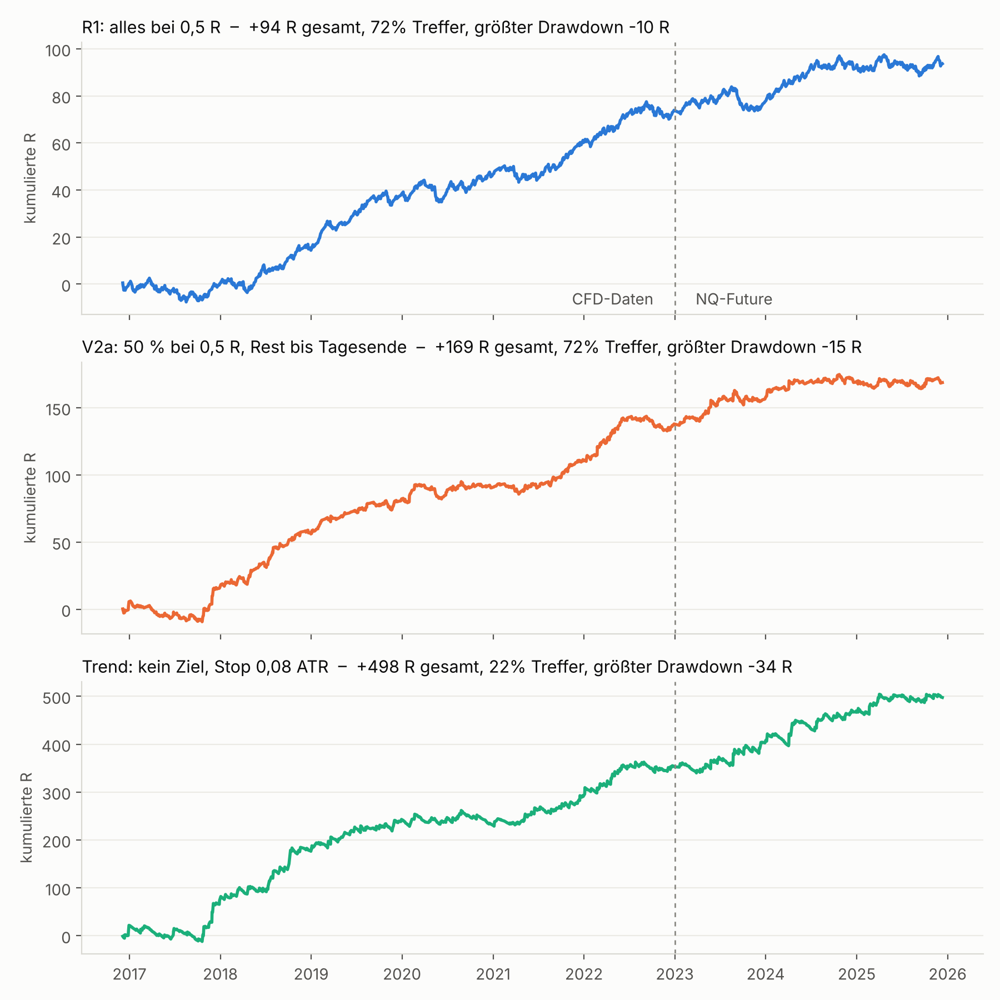

# NQ Open-Drive: Strategie, Optimierung und Forward-Test

Ziel: Trefferquote über 60 %, mehr als 2 Trades pro Woche, positiver Erwartungswert, stabil über beide Datensätze.

## Empfohlene Variante: Trend-Modus

Gleicher Einstieg wie bisher, Stop 0,08 ATR, kein Ziel, Position bis 15:59 halten. Das ist die Standard-Einstellung in `R1_OpenDrive.pine`.

Nach den Daten ist das die beste Variante: höchster Ertrag je Trade und je Jahr, bestes Verhältnis von Ertrag zu Drawdown, und die einzige, die auch von Juli 2024 bis Dezember 2025 verdient hat. Der Preis ist eine Trefferquote von rund 22 %. Eine Variante mit über 60 % Trefferquote, die zuletzt noch funktioniert hat, gibt es in diesen Daten nicht.

| Kennzahl | CFD 2016–2022 | NQ 2023–2025 | zusammen |
|---|---|---|---|
| Handelstage | 1.494 | 722 | 2.216 |
| Trades | 949 | 485 | 1.434 |
| Trades pro Woche | 3,18 | 3,36 | 3,24 |
| Long / Short | 480 / 469 | 242 / 243 | 722 / 712 |
| Trefferquote | 22,8 % | 20,2 % | 21,9 % |
| Ø Gewinn | +5,14 R | +5,56 R | +5,27 R |
| Ø Verlust | −1,03 R | −1,04 R | −1,03 R |
| Realisiertes Chance-Risiko-Verhältnis | 4,97 zu 1 | 5,37 zu 1 | 5,10 zu 1 |
| Median-Gewinn | +4,29 R | +4,94 R | +4,51 R |
| Größter Gewinn | +28,5 R | +21,8 R | +28,5 R |
| Ergebnis je Trade | +0,372 R | +0,298 R | +0,347 R |
| R gesamt | +353,0 R | +144,5 R | +497,5 R |
| R pro Jahr | +59,5 R | +50,4 R | +56,6 R |
| R pro Woche | +1,18 R | +1,00 R | +1,12 R |
| Profitfaktor | 1,47 | 1,36 | 1,43 |
| t-Wert | 3,50 | 2,00 | 4,01 |
| Größter Drawdown | −33,8 R | −25,2 R | −33,8 R |
| Längste Verlustserie | 18 | 24 | 24 |
| Längste Durststrecke (Trades ohne neues Hoch) | 139 | 112 | 139 |
| Positive Monate | 46 von 73 | 21 von 36 | 67 von 109 |
| Ø Haltedauer Gewinner / Verlierer | 313 / 39 Min | 318 / 39 Min | 315 / 39 Min |
| Ø Stop | 15,6 Punkte | 25,1 Punkte | 18,8 Punkte |
| Ausgang | 725 Stop, 224 Tagesende | 381 Stop, 104 Tagesende | 1.106 Stop, 328 Tagesende |

R = Vielfaches des Risikos je Trade (Abstand Einstieg bis Stop). Kosten: 1 Punkt je Kontrakt und Trade; mit 2 Punkten bleiben auf NQ +0,254 R, mit 3 Punkten +0,209 R je Trade.

**Worauf du dich einstellen musst**

- Rund vier von fünf Trades werden ausgestoppt, im Schnitt nach 39 Minuten. Der Gewinn kommt aus dem Fünftel, das bis zum Schluss läuft.
- Serien von 18 bis 24 Verlusten in Folge sind im Backtest vorgekommen, ebenso Strecken von über 130 Trades (rund neun Monate) ohne neues Hoch.
- Die 10 besten von 1.434 Trades liefern 39 % des Gesamtgewinns. Wer an den wenigen starken Tagen nicht dabei ist, hat ein deutlich schlechteres Ergebnis.
- Das Risiko je Trade sollte klein sein: Bei 0,5 % Risiko entspricht der größte Drawdown des Backtests rund 17 % des Kontos.
- Die Wahl dieses Modus ist im Nachhinein auf bekannten Daten gefallen. Erst der Forward-Test zeigt, ob er hält.

**Option Kerzen-Nachzug** (Schalter im Skript, standardmäßig aus): Sobald der Trade 1 × Stop im Gewinn schließt, wandert der Stop nach jeder 1-Min-Kerze in Trade-Richtung auf deren Open. Das macht das Profil ruhiger und kostet rund zwei Drittel des Ertrags:

| | Trend | Trend + Nachzug |
|---|---|---|
| Trefferquote (CFD / NQ) | 22,8 % / 20,2 % | 48,8 % / 49,7 % |
| Ø Gewinn / Ø Verlust | +5,27 / −1,03 R | +1,30 / −1,03 R |
| Ergebnis je Trade (CFD / NQ) | +0,372 / +0,298 R | +0,110 / +0,116 R |
| R gesamt | +497,5 R | +160,7 R |
| R pro Jahr | +56,6 R | +18,3 R |
| Größter Drawdown | −33,8 R | −25,7 R |
| Längste Verlustserie | 24 | 7 |
| Ø Haltedauer Gewinner / Verlierer | 315 / 39 Min | 18 / 12 Min |
| NQ mit 2 / 3 Punkten Kosten | +0,254 / +0,209 R | +0,071 / +0,027 R |

Der Nachzug ist deutlich kostenempfindlicher, weil die Gewinne klein sind und fast jeder Ausstieg eine Stop-Order ist.

**Verluste früher begrenzen** (`losscut_study.py`): Getestet wurden 106 Regeln im Trend-Modus: Ausstieg bei Schlusskurs weiter als x im Minus, Ausstieg ohne Fortschritt nach n Minuten, Ausstieg nach k Kerzen in Folge gegen den Trade, Stop nach n Minuten enger ziehen, Stop auf Einstand, engerer Anfangs-Stop.

- Keine Regel senkt den Drawdown spürbar, ohne mehr Ertrag zu kosten. Der Grund: Gewinner und Verlierer sehen am Anfang zu ähnlich aus. Fünf Minuten nach dem Einstieg liegen 20 % der späteren Gewinner im Minus und 55 % der späteren Verlierer im Plus.
- Der Drawdown entsteht aus der Zahl der Verluste in Folge, nicht aus ihrer Größe. Wer Verluste auf −0,6 R kürzt (Ausstieg ab 0,3 R Minus), senkt die Trefferquote auf 13 % und den Ertrag um ein Viertel.
- **Zeit-Regel** (Schalter im Skript, standardmäßig aus): aussteigen, wenn der Trade 30 Minuten nach dem Einstieg mehr als 0,25 × Stop im Minus schließt. Sie ist als einzige in beiden Datensätzen besser, aber nur leicht: Sie betrifft 4 % der Trades, bringt +0,013 R je Trade und senkt den größten Drawdown von −33,8 auf −31,9 R.
- **Nachzug nur für die halbe Position** (Einstellung „Anteil der Position mit Nachzug“ = 50 %) ist der wirksamste Hebel für ein ruhigeres Profil bei gleichem Verhältnis von Ertrag zu Drawdown:

| | Trend | halbe Position mit Nachzug | ganze Position mit Nachzug |
|---|---|---|---|
| Trefferquote | 21,9 % | 35,3 % | 49,1 % |
| Ø Gewinn / Ø Verlust | +5,27 / −1,03 R | +2,21 / −0,85 R | +1,30 / −1,03 R |
| Ergebnis je Trade (CFD / NQ) | +0,372 / +0,298 R | +0,241 / +0,207 R | +0,110 / +0,116 R |
| R gesamt | +497,5 R | +329,1 R | +160,7 R |
| R pro Jahr | +56,6 R | +37,4 R | +18,3 R |
| Größter Drawdown | −33,8 R | −21,9 R | −25,7 R |
| R pro Jahr je Drawdown | 1,68 | 1,71 | 0,71 |
| Längste Verlustserie | 24 | 12 | 7 |
| Positive Monate | 67 von 109 | 70 von 109 | 64 von 109 |
| NQ mit 2 / 3 Punkten Kosten | +0,254 / +0,209 R | +0,162 / +0,118 R | +0,071 / +0,027 R |

Die halbe Position mit Nachzug braucht mindestens 2 Kontrakte.

## Alle Modi im Vergleich

Der Einstieg ist in allen Modi derselbe. Filter, Wochentage und veränderte Einstiege haben die Gegenprobe nicht bestanden.

**Einstieg („R1“)**

| Regel | Wert |
|---|---|
| ATR | Durchschnitt der Tagesspanne der letzten 14 abgeschlossenen Handelstage |
| Signal | erste 1-Min-Kerze ab 09:31 New York, die 0,3 ATR über (Long) oder unter (Short) dem 09:30-Eröffnungskurs schließt |
| Filter | Tagesspanne seit 09:30 beim Signal höchstens 0,5 ATR; Signal bis 15:29 |
| Einstieg | Schlusskurs der Signalkerze, höchstens 1 Trade pro Tag |

**Ausstiegs-Modi** (alle im Pine-Skript wählbar; 3,2 bis 3,4 Trades pro Woche; Kosten 1 Punkt je Kontrakt und Trade)

| Modus | Datensatz | Trefferquote | Ø Gewinn / Ø Verlust | E je Trade | R pro Jahr | Max. Drawdown | Längste Verlustserie |
|---|---|---|---|---|---|---|---|
| **Trend**: Stop 0,08 ATR, kein Ziel, bis 15:59 halten | CFD 2016–22 | 22,8 % | +5,14 / −1,03 R | +0,372 R | +59,5 | −33,8 R | 18 |
| | NQ 2023–25 | 20,2 % | +5,56 / −1,04 R | +0,298 R | +50,4 | −25,2 R | 24 |
| **Trend + Nachzug**: 1-Min-Kerzen ab 1 R | CFD 2016–22 | 48,8 % | +1,31 / −1,03 R | +0,110 R | +17,6 | −18,5 R | 7 |
| | NQ 2023–25 | 49,7 % | +1,28 / −1,03 R | +0,116 R | +19,6 | −21,6 R | 7 |
| **V2a**: Stop 0,15 ATR, halbe Position bei 0,5 × Stop, danach Stop auf Einstand, Rest bis 15:59 | CFD 2016–22 | 73,1 % | +0,57 / −1,01 R | +0,145 R | +23,3 | −15,4 R | 6 |
| | NQ 2023–25 | 70,5 % | +0,51 / −1,00 R | +0,064 R | +10,8 | −10,8 R | 5 |
| **V2a-75**: wie V2a, Teilverkauf bei 0,75 × Stop | CFD 2016–22 | 62,4 % | +0,85 / −1,00 R | +0,152 R | +24,3 | −19,1 R | 7 |
| | NQ 2023–25 | 60,4 % | +0,78 / −1,00 R | +0,077 R | +13,1 | −14,7 R | 6 |
| **R1**: Stop 0,15 ATR, alles bei 0,5 × Stop | CFD 2016–22 | 73,2 % | +0,48 / −1,01 R | +0,078 R | +12,5 | −10,1 R | 6 |
| | NQ 2023–25 | 70,5 % | +0,48 / −1,00 R | +0,041 R | +6,9 | −10,3 R | 5 |



### Wichtigste Einschränkung

**Die Modi mit hoher Trefferquote haben seit Juli 2024 nichts mehr verdient.** Über die letzten 244 Trades auf NQ: R1 +1,3 R, V2a −1,2 R, V2a-75 +1,1 R. R1 und V2a trafen dabei 68 %; nötig sind 67,8 %. Der Trend-Modus kam im selben Zeitraum auf +64 R, mit Nachzug auf +41 R; ohne Nachzug war sein zweites Halbjahr 2025 mit −2,7 R ebenfalls flach.

Der Vorteil sitzt also in den wenigen Tagen, an denen der Kurs nach dem Ausbruch bis zum Schluss weiterläuft, nicht in den ersten 20 bis 25 Punkten.

### Jahr für Jahr (E je Trade in R)

| Modus | 2017 | 2018 | 2019 | 2020 | 2021 | 2022 | 2023 | 2024 | 2025 |
|---|---|---|---|---|---|---|---|---|---|
| R1 | 0,00 | +0,09 | +0,16 | +0,05 | +0,09 | +0,08 | +0,02 | +0,09 | +0,01 |
| V2a | +0,07 | +0,26 | +0,17 | +0,06 | +0,13 | +0,16 | +0,11 | +0,08 | 0,00 |
| V2a-75 | +0,06 | +0,26 | +0,17 | 0,00 | +0,24 | +0,18 | +0,11 | +0,14 | −0,02 |
| Trend | +0,34 | +0,67 | +0,44 | −0,08 | +0,40 | +0,36 | +0,31 | +0,40 | +0,18 |
| Trend + Nachzug | +0,11 | +0,01 | +0,25 | −0,02 | +0,16 | +0,10 | −0,08 | +0,26 | +0,16 |

### Kosten (NQ 2023–25, E je Trade)

| Kosten je Trade | Trend | Trend + Nachzug | V2a |
|---|---|---|---|
| 1 Punkt | +0,298 R | +0,116 R | +0,064 R |
| 2 Punkte | +0,254 R | +0,071 R | +0,040 R |
| 3 Punkte | +0,209 R | +0,027 R | +0,016 R |

Auf NQ lag der Stop bei V2a im Schnitt bei 47 Punkten (Teilziel 23,5 Punkte), im Trend-Modus bei 25 Punkten.

## Was die Optimierung ergeben hat

Vorgehen: Alles wurde nur auf CFD 2016–2022 ausgewählt (Stufe A 2016–2020, Stufe B 2021–2022), dann eingefroren und committet (`opt_selection.json`) und erst danach auf NQ 2023–2025 geprüft.

### Ausstiege

- **Teil laufen lassen** ist die einzige bestätigte Verbesserung. Gegenüber R1 bringt V2a je Trade +0,071 R (CFD A), +0,061 R (CFD B) und +0,023 R (NQ); über alle 1.434 Trades +0,052 R (t = 2,8). Die Trefferquote bleibt gleich.
- **Engere Stops** bringen bei kleinem Ziel nichts: Ein Viertel der späteren Gewinner läuft vorher mehr als 0,10 ATR gegen den Einstieg. Stops unter 0,10 ATR sind mit Zielen bis 1 × Stop auf CFD A negativ oder praktisch null.
- **Zeit-Stops** (Ausstieg nach 10 bis 180 Minuten) verschlechtern das Ergebnis.
- **Nachgezogene Stops** (Trailing, VWAP-Nachzug) sind schlechter als der Rest ohne Ziel mit Stop auf Einstand.
- **Struktur-Stops** (hinter Signalkerze, hinter dem Tief der letzten 5 bis 20 Kerzen, hinter dem Ausbruchs-Level) sind schlechter als der feste Stop.
- Alle 22 geprüften Abwandlungen von V2a (Stop 0,10 bis 0,22 ATR, Teilverkauf 33 bis 67 %, Teilziel 0,4 bis 1,0 × Stop, Signal 0,25 und 0,35 ATR, mit und ohne Spannen-Filter) sind in allen drei Datensätzen positiv.

### Nachgezogene Stops für offene Positionen (`trail_study.py`)

Offene Positionen geben tatsächlich viel wieder ab. Von den Positionen, die mindestens 1 × Stop im Gewinn lagen, blieb bis 15:59 im Schnitt weniger als die Hälfte des Höchststands:

| Position | lag mindestens im Gewinn | Anteil der Trades | Ø Höchststand | Ø Ergebnis bei Halten bis 15:59 | behalten |
|---|---|---|---|---|---|
| V2a-Rest | 1 R | 37 % | +2,87 R | +1,24 R | 43 % |
| V2a-Rest | 3 R | 12 % | +5,25 R | +3,35 R | 64 % |
| Trend | 1 R | 55 % | +4,57 R | +1,48 R | 32 % |
| Trend | 3 R | 28 % | +7,18 R | +3,65 R | 51 % |

Ein engerer Nachzug holt davon aber nichts zurück. Unterschied zum Halten bis 15:59 in R je Trade, alle Datensätze zusammen:

| Regel (aktiv, sobald der Trade so weit im Gewinn schließt) | V2a | Trend | Stop 0,15 ohne Ziel |
|---|---|---|---|
| Stop auf das Open jeder 1-Min-Kerze in Trade-Richtung, ab 1 R | −0,035 | −0,235 | −0,110 |
| erst nach 2 Kerzen in Folge (Open der ersten), ab 1 R | −0,032 | −0,225 | −0,097 |
| erst nach 3 Kerzen in Folge, ab 1 R | −0,029 | −0,209 | −0,096 |
| 5-Min-Kerzen, ab 1 R | −0,032 | −0,217 | −0,096 |
| 30-Min-Kerzen, ab 1 R | −0,023 | −0,145 | −0,081 |
| 1-Min-Kerzen, erst ab 3 R | −0,018 | −0,151 | −0,053 |
| Stop hinter das Tief/Hoch der letzten 10 Minuten, ab 1 R | −0,033 | −0,216 | −0,096 |
| Stop hinter das Tief/Hoch der letzten 60 Minuten, ab 1 R | −0,020 | −0,115 | −0,066 |
| 50 % des höchsten offenen Gewinns absichern, ab 2 R | −0,010 | −0,197 | −0,037 |
| spätestens 14:00 aussteigen | −0,008 | −0,055 | −0,041 |
| spätestens 15:30 aussteigen | +0,001 | −0,007 | −0,001 |

- Getestet wurden je Modus 112 Kerzen-Regeln (Kerzenlänge 1 bis 30 Minuten, 1 bis 3 Kerzen in Folge, Tief der letzten 3 bis 120 Minuten, aktiv ab 1 bis 5 R). **Keine der 336 Kombinationen ist in allen drei Datensätzen besser** als Halten bis 15:59; 183 sind deutlich schlechter (t < −2).
- Je enger und je früher der Nachzug, desto größer der Verlust. Die lockersten Regeln (3 Kerzen in Folge auf 10- oder 30-Min-Kerzen, erst ab 3 bis 5 R) liegen bei null.
- Der Grund: Ein Rücksetzer, der einen engen Stop auslöst, ist meist nur eine Pause. Die großen Gewinner brauchen diesen Spielraum.
- **Was der Nachzug ändert, ist das Profil:** Im Trend-Modus steigt die Trefferquote mit dem 1-Min-Nachzug ab 1 R von 22 % auf 49 %, die längste Verlustserie fällt von 18 bis 24 auf 7 und der größte Drawdown von −34 R auf −22 R. Der Ertrag fällt dabei von +0,37 / +0,30 R auf +0,11 / +0,12 R je Trade (CFD / NQ).
- Die letzte halbe Stunde bringt nichts: Ausstieg um 15:30 oder 15:45 ist gleichwertig mit 15:59.

### Einstiege (CFD, E je Trade mit V2a-Ausstieg: Stufe A / Stufe B)

| Variante | Ergebnis |
|---|---|
| bisheriger Einstieg | +0,145 / +0,147 |
| Stop-Order direkt am Level (ohne Schlusskurs-Bestätigung) | +0,133 / +0,047 |
| zwei Schlusskurse in Folge jenseits des Levels | +0,074 / +0,149 |
| Bestätigung: Stop-Order über der Signalkerze | +0,155 / +0,203, aber 10 % weniger Trades; Gesamtertrag in A niedriger |
| Rücksetzer-Limit am Level (15 bis 120 Minuten gültig) | +0,04 / +0,09 |
| tageszeitabhängige Schwelle (mittlere Bewegung der letzten 14 Tage zur selben Uhrzeit) | gleichwertig, nicht besser |
| andere feste Schwellen (0,15 bis 0,5 ATR) | keine ist in beiden Stufen besser als 0,3 ATR |

Keine Variante ist in beiden Stufen besser.

### Filter

- Geprüft wurden 38 Merkmale: Uhrzeit, Tagesspanne, Gegenbewegung, Größe und Schluss der Signalkerze, Momentum, Abstand zur VWAP, Lücke, Overnight-Richtung und -Spanne, Vorbörse, 08:30-Ausschlag, Stdv-Box (Richtung, Größe, Lage), Vortageshoch/-tief, Vortagesspanne, 1-, 5- und 20-Tage-Trend, Volatilitäts-Regime, enge und weite Vortage, Inside Days, relatives Volumen, Long gegen Short.
- Auf dem CFD waren 7 Merkmale auffällig (p < 0,05). Am stärksten war die **Lage der Eröffnung in der Overnight-Spanne**: Trades in Richtung der Overnight-Bewegung brachten +0,27 / +0,24 R, die übrigen +0,03 / +0,04 R, in beiden Stufen gleich.
- **Auf NQ ist davon nichts übrig:** +0,067 R gegen +0,060 R (p = 0,94). Keines der 7 Merkmale ist auf NQ signifikant.
- Kontrolle: CFD und NQ liefern im gemeinsamen Zeitraum 2023–2025 praktisch dieselben Trades (gleiche Richtung 100 %, gleicher Ausgang 97 %). Der Unterschied liegt also am Zeitraum, nicht an der Datenquelle.
- Kreuzvalidiert über alle neun Jahre (Modell auf acht Jahren trainiert, auf dem neunten getestet) trennt eine Kombination aller Merkmale die Trades kaum: obere gegen untere Hälfte +0,04 R (t = 0,8).

### Wochentage (E je Trade mit V2a-Ausstieg)

| Tag | CFD 2016–20 | CFD 2021–22 | NQ 2023–25 |
|---|---|---|---|
| Montag | +0,27 | +0,33 | +0,02 |
| Dienstag | +0,09 | +0,11 | +0,10 |
| Mittwoch | +0,13 | −0,11 | +0,04 |
| Donnerstag | +0,09 | +0,21 | +0,03 |
| Freitag | +0,14 | +0,19 | +0,12 |

Kein Wochentag ist verlässlich besser oder schlechter (Varianzanalyse p = 0,61 / 0,16 / 0,93). Der Montags-Vorteil auf dem CFD verschwindet auf NQ. Einzelne Tage wegzulassen senkt nur die Zahl der Trades.

### Long gegen Short (V2a)

Longs sind in allen drei Datensätzen besser als Shorts (+0,19 / +0,19 / +0,11 R gegen +0,10 / +0,11 / +0,02 R). Beide Seiten sind positiv; in einem fallenden Markt kann sich das umkehren, deshalb bleibt beides aktiv.

## Wie R1 gefunden wurde (erste Suche)

1. **Ereignistabelle** (`build_events.py`): rund 205.000 mögliche Einstiege auf dem CFD und 107.000 auf NQ. Reclaims an Stdv-Box, Psych-Leveln, Tages- und Overnight-Leveln, VWAP, FVG, iFVG, Order Block und Rejection Block; Ausbrüche von der Eröffnung, aus der Opening Range, über Tagesextreme und aus der Indecision-Box.
2. **Suche** (`search.py`): 919.025 Kombinationen aus Einstieg, Trendbedingung, Zeitfenster, bis zu 2 Zusatzbedingungen und Ausstieg. 717 bestehen CFD 2016–2020, 371 davon auch CFD 2021–2022.
3. **Endtest** (`final_test.py`): fünf eingefrorene Kandidaten auf NQ, zwei bestehen. Danach drei Verfeinerungen, aus denen R1 stammt.

Fast alle 371 Treffer folgen einem Prinzip: mit der Bewegung handeln, wenn der Kurs mindestens 0,3 ATR von der Eröffnung entfernt ist. Einstiege gegen die Bewegung sind durchgehend negativ. Stdv-Level, Psych-Level, VWAP und ICT-Zonen bestehen nur zusammen mit dieser Trendbedingung und dann schlechter als der schlichte Ausbruch; der Psych-Level-Kandidat fiel auf NQ durch. Die Indecision-Box besteht in keiner Variante.

## Einschränkungen

- **NQ 2023–2025 wurde dreimal als Gegenprobe benutzt** und ist kein unberührter Test mehr. Der eigentliche Test ist der Forward-Test.
- **Die Modi wurden im Nachhinein verglichen.** Dass der Trend-Modus zuletzt besser war, ist eine Beobachtung auf bekannten Daten.
- **Der Trend-Modus lebt von wenigen Trades:** Die 10 besten von 1.434 Trades liefern 39 % des Gesamtgewinns. Bei 25 Punkten Stop wiegt zusätzlicher Slippage schwerer als bei V2a.
- **V2a braucht mindestens 2 Kontrakte**, damit der Teilverkauf möglich ist (praktisch: MNQ).
- **GEX wurde nicht getestet** (keine Optionsdaten).
- **Indecision-Box** ist hier definiert als 5-Min-Kerze mit Körper höchstens 20 % der Spanne und Spanne mindestens 0,03 ATR; Ausbruch per 1-Min-Schluss binnen 30 Minuten.
- **Das Pine-Skript ist nicht in TradingView kompiliert oder gegen die Trade-Listen abgeglichen.**
- Liegen Stop und Ziel in derselben Minutenkerze, zählt im Backtest der Stop. Der Stop auf Einstand gilt ab der Kerze nach dem Teilverkauf.

## Forward-Test

1. `R1_OpenDrive.pine` auf dem 1-Minuten-Chart von NQ oder MNQ laden, Chart mit vollständiger Handelszeit (sonst stimmt die ATR nicht). Die Standard-Einstellung ist der Trend-Modus.
2. Zum Vergleich eine zweite Instanz mit eingeschaltetem Kerzen-Nachzug oder im Modus „Teilverkauf + Runner“ laufen lassen. Der Einstieg ist derselbe; so zeigt sich, welcher Ausstieg trägt.
3. Im Strategy Tester die letzten Wochen mit den Trade-Listen in `results/` vergleichen: `trend_trades_NQ.csv`, `trend_nachzug_trades_NQ.csv`, `trend_halb_nachzug_trades_NQ.csv`, `trend_zeitregel_trades_NQ.csv`, `v2a_trades_NQ.csv`, `r1_trades_NQ.csv`.
4. „Nur ab Startdatum handeln“ einschalten. Im Trend-Modus sagt die Trefferquote wenig; entscheidend ist die Summe in R über mindestens 150 Trades (etwa ein Jahr). Eine Verlustserie von 20 Trades ist dabei kein Zeichen, dass die Strategie nicht mehr funktioniert.

## Dateien

| Datei | Inhalt |
|---|---|
| `R1_OpenDrive.pine` | TradingView-Strategie: Trend-Modus als Standard, Kerzen-Nachzug als Schalter, V2a und R1 wählbar |
| `r1_strategy.py` | eigenständige Nachrechnung Kerze für Kerze, Kennzahlen aller Modi, Trade-Listen |
| `plot_modes.py` | Kapitalkurven |
| `opt_data.py`, `opt_lib.py` | Daten-Cache und Werkzeuge der Optimierung |
| `opt_selection.json`, `opt_final.py` | eingefrorene Kandidaten und Gegenprobe |
| `trail_study.py` | Test nachgezogener Stops für offene Positionen |
| `losscut_study.py` | Test früher Verlustbegrenzung im Trend-Modus |
| `build_events.py`, `search.py`, `selection.json`, `final_test.py` | erste Suche |
| `results/` | Trade-Listen |

```bash
python final/r1_strategy.py && python final/plot_modes.py
python final/opt_data.py /tmp/opt && python final/opt_final.py /tmp/opt
```
